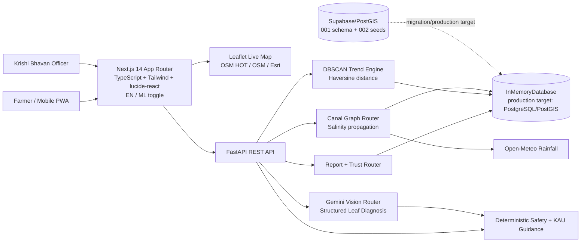
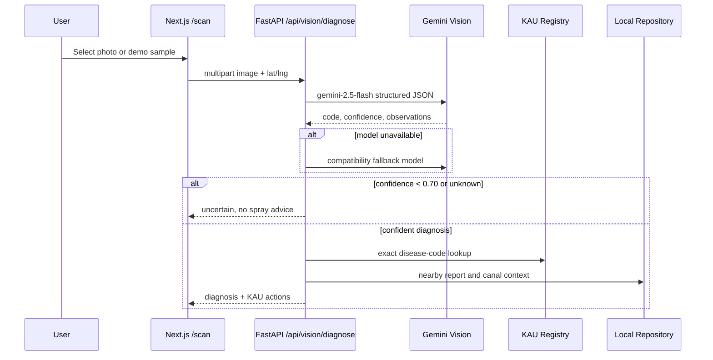
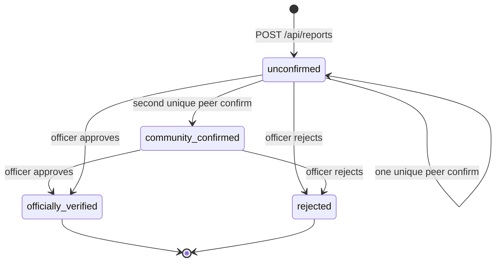

# Karshakan Lens Architecture

## System overview

## Main runtime modules

| Layer | Current implementation | Responsibility |
|---|---|---|
| Presentation | `frontend/src/app`, `components`, `lib/api.ts` | Map, scan, report, verification, alerts, filters, GPS/preset locations |
| Mapping | `KuttanadMap.tsx` | Report pins, canal lines, DBSCAN circles, 3 km trend ring, fit-to-data view |
| API | `backend/app/main.py` and routers | REST endpoints, request validation, response shaping |
| Intelligence | `services/clustering.py`, `canal_routing.py`, `remedies.py` | DBSCAN, salinity graph traversal, curated KAU actions |
| Vision | `routers/vision.py` | Gemini structured diagnosis, demo samples, confidence guardrail |
| Repository | `services/db.py` | Seeded in-memory runtime with spatial emulation and trust state |
| Production schema | `supabase/*.sql` | PostGIS tables, indexes, canal helper, seed data |

## Request paths

### Leaf scan

### Trust and report path

## Deployment boundaries

The current demo starts without Supabase because `InMemoryDatabase` is preloaded with Kuttanad geography and reports. The SQL migrations are the production database design. Before production, connect a PostGIS repository, add authenticated role claims, restrict CORS, and wire the planned Sarvam voice service.
