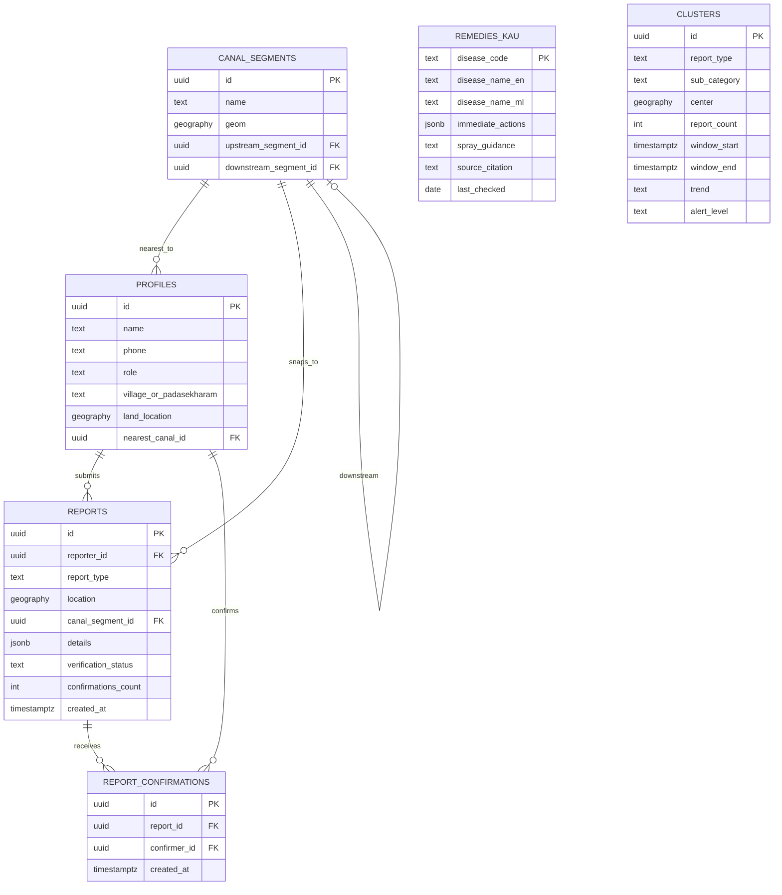
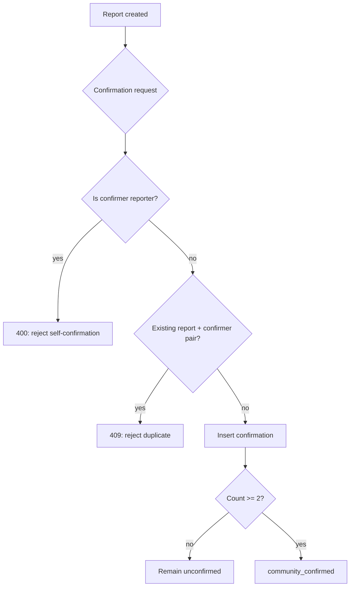

# Karshakan Lens Database Architecture

## Production data model

## Spatial design

- `profiles.land_location` and `reports.location` use `geography(Point, 4326)`.
- `canal_segments.geom` uses `geography(LineString, 4326)`.
- `clusters.center` uses `geography(Point, 4326)`.
- GiST indexes support point, line, and cluster spatial lookups.
- `find_nearest_canal_segment(pt_geog)` orders canal segments by `ST_Distance` and returns the nearest canal.
- The local Python repository mirrors the same behavior with Haversine distance and point-to-linestring sampling.

## Privacy model

`reporter_id`, names, and phone numbers are private data. They are stored internally for trust checks but are removed by `db.to_public_response()` before public map, report, officer, and trend responses. Officer verification stores an officer reference in internal report details; it is not exposed as a farmer identity.

## Trust integrity

## Runtime versus migration state

`supabase/001_init_postgis.sql` and `002_seed_kuttanad.sql` define the intended persistent schema and seeded geography. The current demo uses `backend/app/services/db.py` so judges can run it locally without a database. A production migration should replace repository methods with Postgres/PostGIS queries while preserving the public anonymization boundary.
