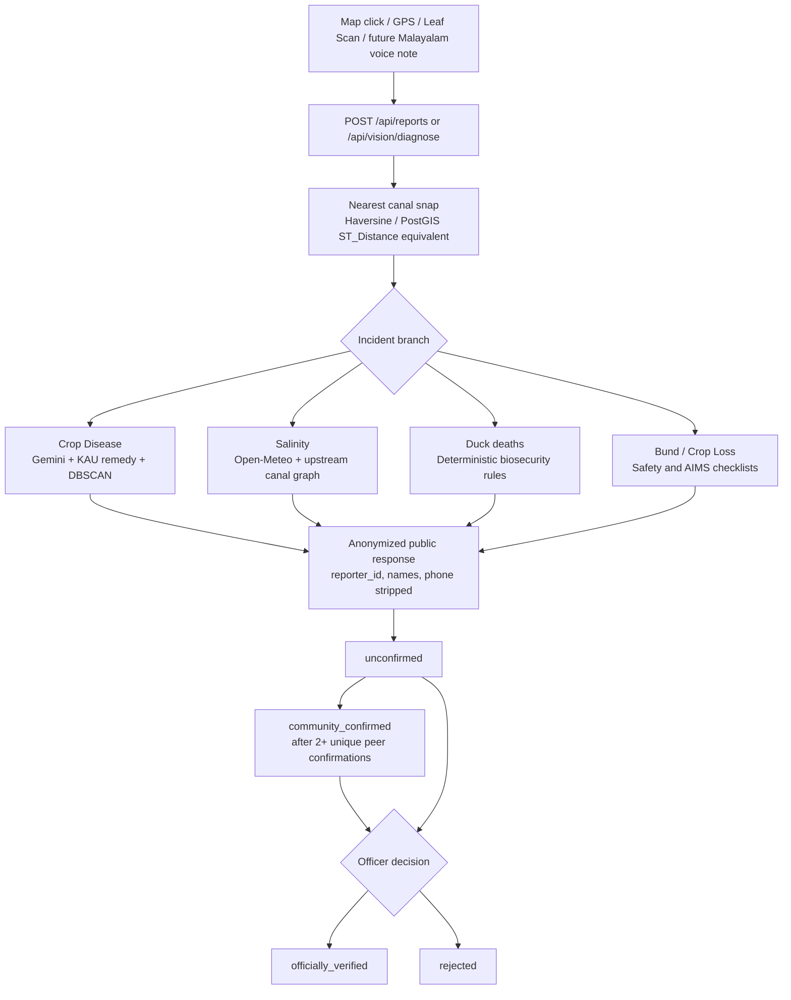
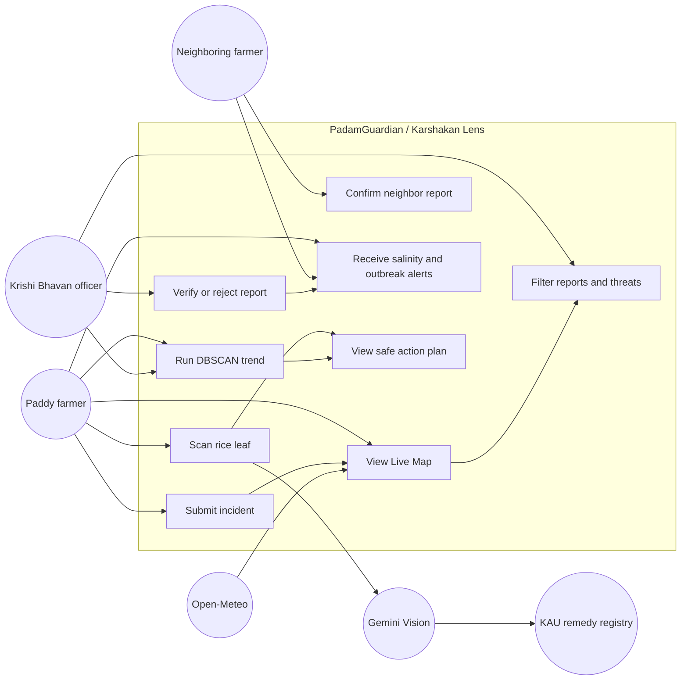

# PadamGuardian / Karshakan Lens

## Overview

Karshakan Lens is a mobile-first PWA for Kuttanad farmers and Krishi Bhavan officers. It combines:

- **Place & People:** GPS-tagged reports, padasekharam/canal context, peer confirmations, and officer verification.
- **Physical-world computing:** nearest-canal snapping, canal salinity propagation, Open-Meteo rainfall telemetry, Leaflet mapping, and Gemini Vision leaf diagnosis.
- **Voice & language:** English-first UI with an `EN / ML` toggle. `notes_text` is reserved for future Sarvam Malayalam STT/TTS; Sarvam is not currently wired as a live API dependency.

The platform turns a local observation into a spatially aware warning, a vetted agronomic action, and a trusted community record.

## Solution

**PadamGuardian / Karshakan Lens solves Alappuzha's crop-outbreak visibility problem by turning scattered farmer observations into trusted, map-based outbreak intelligence.** A farmer uploads a leaf, drops a GPS pin, or reports a field issue. The system diagnoses or classifies the observation, snaps it to the nearest canal/padasekharam, compares current and previous activity, and shows whether nearby reports form a growing outbreak.

The solution combines Gemini Vision, curated KAU remedies, community verification, canal-aware context, and **Haversine DBSCAN**. DBSCAN is the core engine that distinguishes a real disease outbreak from isolated reports and shows where the outbreak is spreading.

## Main Problem: Crop Disease Outbreaks

Alappuzha's Kuttanad farming belt is a connected disease-spread environment. Paddy plots are packed into embanked *padasekharams*, humidity remains high, and farmers often see the first symptoms days before a field inspection reaches every polder. Brown Planthopper (*chazhi*), hopperburn, Sheath Blight, Bacterial Leaf Blight, Rice Blast, Sheath Rot, Brown Leaf Spot, Rice Tungro, Stem Borer, Leaf Folder, Gall Midge, Hispa, False Smut, and Grain Discoloration can spread across neighboring fields quickly.

The practical problem is not only diagnosis. It is knowing when several observations represent the same outbreak, where it is moving, and which farmers or officers need to act first.

### How It Works

- **Field signal:** `/scan` accepts a real leaf photo and returns a structured disease code, confidence, visual observations, and image quality.
- **Safety boundary:** confidence below 0.70 returns `Not sure — ask your Krishi Bhavan` with no chemical spray advice.
- **Trusted action:** confident results use a disease-code lookup in the curated KAU remedy registry; Gemini does not invent dosages.
- **Spatial intelligence:** current reports are grouped by disease and location with Haversine DBSCAN.
- **Human validation:** reports become `community_confirmed` after two unique peer confirmations and can then be officially verified.
- **Decision view:** the Live Map and “What's Spreading Now” panel show current versus previous counts, cluster centers, affected areas, and actions.

## Other Kuttanad Problems

Kuttanad spans Alappuzha and Kottayam districts of Kerala and is widely known for below-sea-level farming. Paddy is cultivated inside embanked polders called *padasekharams*, often around 1.5–2.5 metres below sea level, with interconnected canals and Vembanad Lake controlling the water system.

### Problems and Solutions

1. **Tidal salinity intrusion (*uppuvellam*) and shutter leakage**

   Brackish water can travel inland from Vembanad during high tides, low-flow periods, or Thanneermukkom Bund/spillway shutter problems. Water above the app's 2.0 ppt danger threshold can damage paddy roots and grain filling, contributing to quality deductions (*kizhivu*).

   **Solution:** salinity reports are snapped to canals and routed through connected upstream segments. Open-Meteo rainfall becomes a freshwater-dilution signal. Warnings follow the canal graph, not an arbitrary circular radius, and return pump and sluice-gate guidance.

2. **Rapid pest and fungal epidemics**

   Brown Planthopper (*chazhi*), Sheath Blight, Bacterial Leaf Blight, Rice Blast, Sheath Rot, Brown Leaf Spot, Rice Tungro, Stem Borer, Leaf Folder, Gall Midge, Hispa, False Smut, and Grain Discoloration can spread through humid contiguous fields.

   **Solution:** Gemini Vision diagnoses leaf images, confidence below 0.70 becomes `Not sure — ask your Krishi Bhavan`, confident diagnoses use deterministic KAU Package of Practices guidance, and recent reports are grouped with Haversine DBSCAN.

3. **Outer ring-bund seepage (*madaveezhcha*) and piping breaches**

   Waterhead pressure can create internal piping in earthen bunds. A missed leak can breach a bund and flood standing paddy rapidly.

   **Solution:** geotagged `bund_seepage` reports retain exact field context and return reverse-filter sandbagging, pumping, and escalation guidance.

4. **Duck mortality and avian-biosecurity risk**

   Duck flocks share canals and backwaters. Delayed reporting of sudden mortality can allow a disease event to move between flocks.

   **Solution:** `bird_deaths` reports receive isolation/deep-burial/veterinary notification guidance and can form mortality clusters.

5. **Missed 72-hour crop-loss evidence windows**

   Farmers can lose insurance eligibility when timestamped and geotagged evidence is not captured promptly after a calamity.

   **Solution:** `crop_loss` reports preserve coordinates, timestamps, notes, and structured loss details for officer review, with deterministic AIMS/PMFBY evidence guidance.

## Why DBSCAN

DBSCAN (Density-Based Spatial Clustering of Applications with Noise) uses geographic Haversine distance. The interactive trend endpoint uses a 7-day current window, a prior comparison window, requested `eps` (default 2.0 km), and `min_samples=3`. The map feed uses configured overview defaults.

- **Irregular geography:** fields follow canals, bunds, and winding waterways rather than square grid cells.
- **Noise filtering:** isolated reports remain noise rather than causing a false regional alarm.
- **No cluster-count guess:** unlike K-Means, DBSCAN does not require a predetermined number of outbreaks.
- **Interactive comparison:** users can choose a GPS point, map point, or padasekharam preset, run `POST /api/trends/analyze`, compare clustered versus noise reports, and retain multiple location runs.

## User Flows

### Farmer Flow

1. Opens the PWA, uses the `EN / ML` toggle, and uses GPS or a dropped map pin to check local reports, rainfall, and canal salinity.
2. Sees yellowing leaves and opens `/scan`, uploads a photo, or tries a demo sample.
3. Receives a KAU action plan or the safe low-confidence fallback. The current code does not yet include live Sarvam STT/TTS.
4. Reports the diagnosis to the Live Map and receives subsequent alerts as neighbors confirm the event.

### Neighbor Flow

1. Sees an amber `unconfirmed` report in Verify Queue or Alerts.
2. Confirms it once. Self-confirmation and duplicate votes are blocked; the second unique peer confirmation promotes it to `community_confirmed`.

### Officer Flow

1. Filters by category, disease, verification state, and 24-hour/7-day/14-day window.
2. Compares Pulincunnoo, Alappuzha, Kumarakom, Thrissur Kole, or Palakkad with Find Trend (Run DBSCAN).
3. Marks reports `officially_verified` or `rejected` and prioritizes growing clusters, Danger canal branches, mortality events, and bund seepage.

## Report Flow



## Architecture

```mermaid
flowchart LR
  subgraph Frontend[Next.js 14 PWA]
    UI[TypeScript + Tailwind + lucide-react\nEN / ML translation]
    Map[Leaflet\nOSM HOT / OSM / Esri Satellite]
    Views[Live Map | Leaf Scan | Report\nVerify Queue | Alerts]
    UI --> Map
    UI --> Views
  end
  subgraph Backend[FastAPI REST Backend]
    API[REST /api]
    Trust[Report branching\nTrust state machine]
    Gemini[Gemini Vision router\nKAU remedy lookup]
    DBSCAN[Haversine DBSCAN engine]
    Canal[Canal graph + Open-Meteo router]
    API --> Trust
    API --> Gemini
    API --> DBSCAN
    API --> Canal
  end
  subgraph Data[Data layer]
    Runtime[(InMemoryDatabase\ncurrent demo runtime)]
    PostGIS[(PostgreSQL + PostGIS\nSupabase migrations / production target)]
  end
  Frontend -->|JSON REST| API
  Trust --> Runtime
  Gemini --> Runtime
  DBSCAN --> Runtime
  Canal --> Runtime
  PostGIS -. schema and seed target .-> Runtime
```

The running demo currently uses `InMemoryDatabase` in `backend/app/services/db.py`, seeded at startup. The SQL migrations describe the production PostGIS design; a live Supabase/Postgres repository is not yet connected to the FastAPI runtime.

## Documentation

- [ARCHITECTURE.md](ARCHITECTURE.md) — detailed Mermaid system architecture, request paths, runtime modules, and deployment boundaries.
- [DB.md](DB.md) — Mermaid entity-relationship model, PostGIS spatial design, privacy boundaries, indexes, and trust integrity.
- [WORKFLOW.md](WORKFLOW.md) — detailed crop-outbreak, DBSCAN, salinity, multi-location trend, and trust-verification workflows.

Use these three guides alongside this README: the README explains the product and judge story, `ARCHITECTURE.md` explains component relationships, `DB.md` explains data ownership and spatial storage, and `WORKFLOW.md` explains how a field observation becomes a verified action.

## Screenshots

Place final screenshots in `docs/screenshots/` using the filenames below. These placeholders make the README ready for visual evidence without committing browser chrome or personal data.

### Live Map

<!-- Screenshot placeholder: Live Map showing Kuttanad pins, canals, DBSCAN circles, telemetry, and the “Show All Data” control. -->


### Filters

<!-- Screenshot placeholder: Filters & Find Trend panel showing category, disease, verification, time-window, and Reports/Clusters/Canals toggles. -->


### Trend Analysis

<!-- Screenshot placeholder: selected location, 3 km ring, highlighted cluster, cluster/noise counts, current-vs-prior counts, and canal status. -->


### Leaf Scan

<!-- Screenshot placeholder: real demo leaf image, disease name, confidence, visual clues, and vetted KAU action plan. -->


### Safety State

<!-- Screenshot placeholder: blurry sample showing “Not sure — ask your Krishi Bhavan” and no chemical advice. -->


### Verification

<!-- Screenshot placeholder: submitted map report, Verify Queue confirmation state, and officer verification view. -->


### Capture Tips

- Use a clean 1440×900 or 1280×800 browser viewport.
- Capture the app only; exclude browser tabs, API keys, phone numbers, and personal GPS details.
- Prefer one screenshot per capability, with the important panel fully visible.
- For the strongest demo set, capture Pulincunnoo, Alappuzha, Kumarakom, or Palakkad as the selected trend location.

## Database

| Table | Purpose | Spatial/integrity details |
|---|---|---|
| `profiles` | Farmer and officer profiles | `geography(Point, 4326)`, role and farm metadata, GiST index |
| `canal_segments` | Connected waterways | `geography(LineString, 4326)`, upstream/downstream keys, GiST index |
| `reports` | Crop, water, bird, bund, and loss events | `geography(Point, 4326)`, type/status/time indexes, private `reporter_id` |
| `report_confirmations` | Peer trust votes | `UNIQUE (report_id, confirmer_id)` anti-duplication constraint |
| `remedies_kau` | Curated disease/pest actions | Disease-code primary key, citation, cultural and approved guidance |
| `clusters` | Persistable DBSCAN outputs | Center, window, count, trend, and alert level |

`supabase/001_init_postgis.sql` defines `find_nearest_canal_segment(pt_geog)`, which orders canal geometries by spatial distance. The local repository mirrors this with Haversine point-to-linestring emulation.

## AI Integration

### Gemini Vision

`POST /api/vision/diagnose` accepts multipart image uploads or JSON demo inputs. The primary configured model is `gemini-2.5-flash`; if Google returns the model-unavailable 404 seen for some new accounts, the implementation retries with Google's recommended compatibility model.

Structured output is constrained to:

```text
brown_planthopper | sheath_blight | bacterial_leaf_blight | rice_blast
sheath_rot | brown_leaf_spot | rice_tungro | unknown
```

Responses include confidence, visual observations, image quality, nearby report count, and nearest canal. Below 0.70, no KAU spray guidance is returned. At or above 0.70, the disease code is used only as a lookup key into `KAU_REMEDIES_REGISTRY`; Gemini never generates chemical dosages.

The scanner includes three offline samples plus the real `frontend/demo data/image.png` asset. The real demo image has been tested through the Gemini upload path and returned a Rice Blast result with a KAU action plan.

### Sarvam Status

The product design reserves `saaras:v3`/`saarika:v2.5` STT and `bulbul:v3`/`bulbul:v2` TTS for Malayalam `ml-IN` voice notes and spoken action plans. Sarvam is not currently wired as a live SDK, router, or dependency in this repository. The current safe path is typed notes, scanner observations, curated KAU text, and the EN/ML UI toggle.

## API

| Method | Endpoint | Purpose |
|---|---|---|
| `GET` | `/api/map-feed` | Filtered reports, clusters, canals, rainfall, and outbreak breakdown |
| `POST` | `/api/reports` | Create a public-anonymized incident report |
| `POST` | `/api/reports/{id}/confirm` | Add a unique peer confirmation |
| `POST` | `/api/reports/{id}/verify` | Officer verification or rejection |
| `POST` | `/api/trends/analyze` | Multi-location Haversine DBSCAN trend run |
| `POST` | `/api/vision/diagnose` | Gemini/offline leaf diagnosis and KAU lookup |
| `GET` | `/api/officer/dashboard` | Officer queue, clusters, critical canals, digest |
| `GET` | `/api/remedies/{disease_code}` | KAU remedy lookup |
| `GET` | `/api/alerts` | Salinity, cluster, and verification alerts |
| `GET` | `/api/trends/local` | Local radius trend and nearest-canal context |

Public report, map, and officer response models omit `reporter_id`, names, and phone numbers.

## Setup

### Backend

```powershell
python -m pip install -r backend/requirements.txt
```

Create/edit `backend/.env`:

```env
GEMINI_API_KEY=your_gemini_key
SARVAM_API_KEY=                 # reserved for planned voice integration
```

Start from the repository root:

```powershell
python -m uvicorn backend.app.main:app --host 0.0.0.0 --port 8000 --reload
```

Swagger: http://localhost:8000/docs

Run the existing backend suite:

```powershell
python backend/tests/run_tests.py
```

Expected result: **8 passed, 0 failed**. Startup demo data is marked `is_sample: true` and includes Kuttanad plus comparison points in Alappuzha, Kumarakom, Changanassery, Cherthala, Thiruvalla, Kayamkulam, Kollam, Ernakulam, Thrissur Kole, and Palakkad.

### Frontend

```powershell
cd frontend
pnpm install
pnpm dev
```

Open http://localhost:3000. Use `/scan` for the Leaf Scan flow, `/` for Live Map and DBSCAN comparison, `/report` for manual incidents, `/verify` for trust progression, and `/alerts` for the notification inbox.

### Supabase/PostGIS

Run in the Supabase SQL editor, in order:

```text
supabase/001_init_postgis.sql
supabase/002_seed_kuttanad.sql
```

These create the six core tables, spatial indexes, canal seed graph, KAU remedies, profiles, and sample reports. The local FastAPI demo does not require Supabase to start.

## Safety and Privacy

- Low-confidence leaf diagnosis never exposes chemical spray advice.
- KAU actions are deterministic registry lookups, not generated treatment plans.
- Public feeds strip reporter identity fields.
- Demo login is simplified and is not production authentication.
- `backend/.env` is ignored by Git; never commit API keys.
- OpenStreetMap/Esri and Open-Meteo are external services; fallback data keeps core demo flows usable.
- Production hardening should connect PostGIS, add authenticated role claims, restrict CORS, wire Sarvam, and replace deterministic classifier fallbacks with an audited model/service.


**Core thesis:** PadamGuardian connects place, people, and practical agronomy before a local warning becomes a regional loss.

## Use Case Diagram



### Use-Case Diagram Key

| Diagram box | Meaning |
|---|---|
| **Paddy farmer** | Uses GPS, Leaf Scan, manual reporting, trend analysis, and alerts to protect a field. |
| **Neighboring farmer** | Reviews nearby unconfirmed reports and adds a community confirmation. |
| **Krishi Bhavan officer** | Filters incidents, runs DBSCAN comparisons, and officially verifies or rejects reports. |
| **Live Map** | Shows anonymized reports, canal alerts, outbreak circles, and selected locations. |
| **Filters** | Hides irrelevant categories, diseases, time windows, verification states, and map layers. |
| **Leaf Scan** | Sends a leaf image to Gemini Vision and displays the confidence-safe KAU action plan. |
| **Submit incident** | Creates a crop, salinity, bird, bund, or crop-loss report. |
| **Run DBSCAN trend** | Finds local disease/threat clusters, isolated noise, growth, and 3 km location context. |
| **Confirm neighbor report** | Adds a unique peer confirmation and can promote a report to `community_confirmed`. |
| **Verify or reject report** | Represents the officer review step in the trust lifecycle. |
| **Receive alerts** | Delivers salinity, outbreak, and verification updates to the farmer or officer. |
| **View safe action plan** | Shows deterministic KAU or safety guidance; uncertain AI results show no chemical advice. |
| **Gemini Vision** | Produces structured disease code, confidence, and visual observations from a leaf image. |
| **KAU remedy registry** | Supplies curated disease actions and source citations instead of generated treatments. |
| **Open-Meteo** | Supplies rainfall telemetry used for salinity dilution analysis. |
