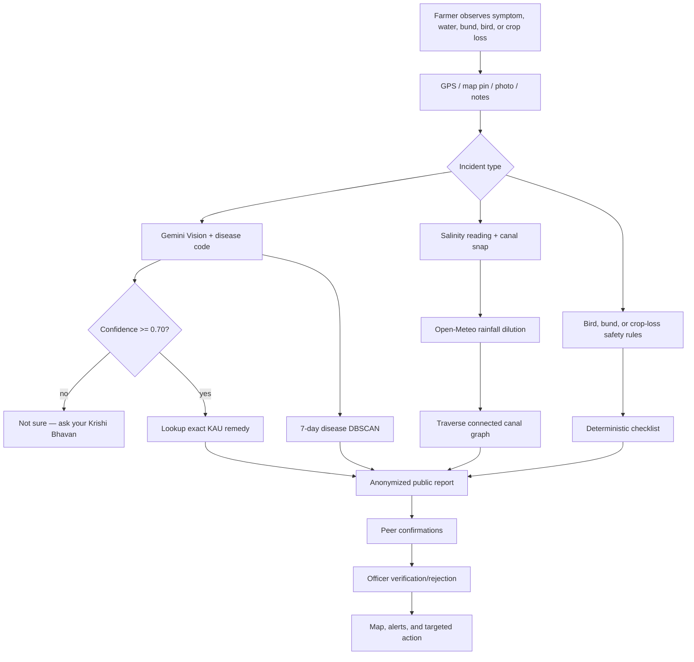
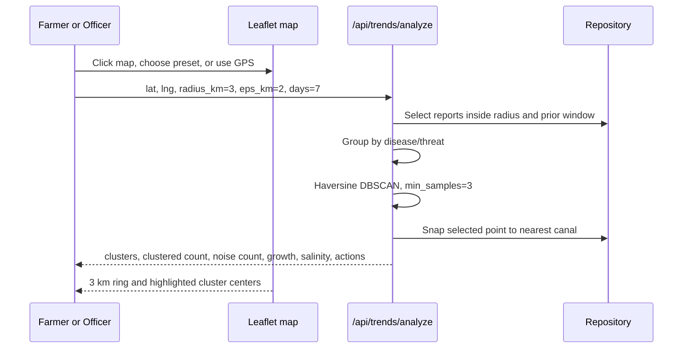

# Karshakan Lens Operating Workflow

## The core loop



## Crop outbreak workflow

1. A farmer opens `/scan`, uploads a leaf photo, or chooses the bundled demo image.
2. The frontend sends the image and optional coordinates to `POST /api/vision/diagnose`.
3. Gemini returns structured `disease_code`, `confidence`, `visual_observations`, and `image_quality_note`.
4. If confidence is below 0.70 or the result is `unknown`, the response contains no chemical advice.
5. If confident, the backend uses the code as a key into the KAU registry for immediate cultural actions, spray guidance, and source citation.
6. The farmer can submit the result to `POST /api/reports` with disease code, confidence, visual notes, and GPS coordinates.
7. The Live Map includes the new anonymized pin and recalculates active disease clusters.

## Why DBSCAN matters

DBSCAN is the most important outbreak step because a disease name alone does not tell a farmer whether the problem is isolated or spreading. The engine:

- converts latitude/longitude to radians for the Haversine metric;
- searches a configurable neighborhood, normally 2.0 km for the map view;
- uses `min_samples=3` in interactive trend analysis so three nearby reports are needed to form a cluster;
- leaves isolated observations as noise rather than escalating them as a regional outbreak;
- compares a current window with the prior window to label growth as `Growing Spike`, `Active Cluster`, `Watch`, or `Isolated Noise`;
- returns cluster centers that the map renders as circles and that a farmer or officer can scan with a 3 km analysis ring.

## Multi-location trend workflow



## Salinity workflow

1. A farmer submits a salinity reading with coordinates or a canal segment.
2. The backend snaps the location to the nearest canal when needed.
3. `fetch_kuttanad_rainfall()` obtains or falls back to a rainfall summary.
4. `analyze_salinity_propagation()` follows upstream connected segments.
5. Each segment receives Watch, Warning, or Danger based on salinity and dilution.
6. The map highlights canal lines; this path intentionally does not use a circular outbreak radius.

## Trust workflow

```text
unconfirmed
   | one unique neighbor
unconfirmed
   | second unique neighbor
community_confirmed
   | Krishi Bhavan officer
+----------------------+
|                      |
officially_verified   rejected
```

Self-confirmation is blocked, duplicate confirmation is rejected with a conflict, and only an officer profile can perform official verification in the demo state machine.

## Demo checklist

1. Start backend and frontend.
2. Open `/scan` and choose **Demo Data Folder: Rice Leaf Photo**.
3. Run the Gemini diagnosis and review the KAU plan.
4. Report the issue to the Live Map.
5. Open `/`, click **Show All Data**, then open **Filters & Find Trend**.
6. Scan Pulincunnoo, Alappuzha, Kumarakom, Thrissur Kole, and Palakkad with the 3 km trend tool.
7. Compare clusters versus isolated noise and current versus prior counts.
8. Use Verify Queue to demonstrate peer confirmation and officer verification.
